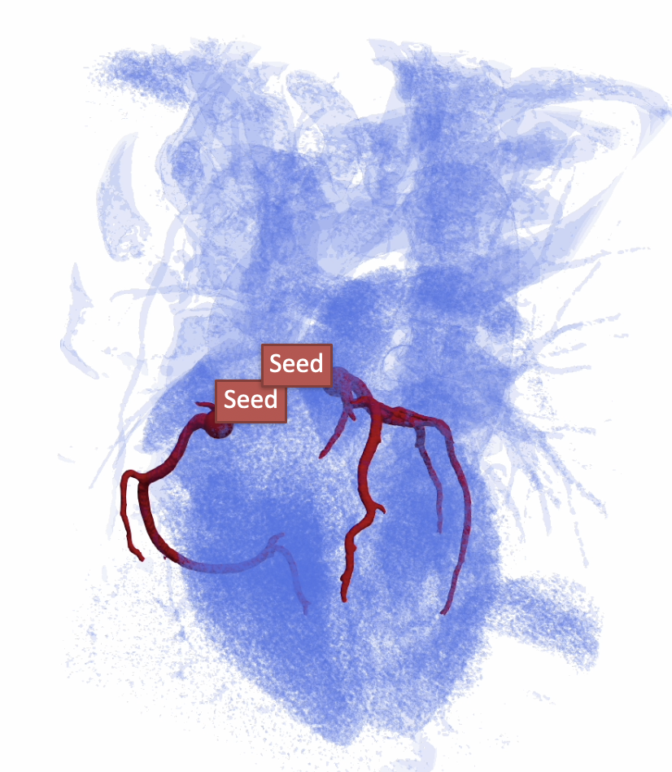
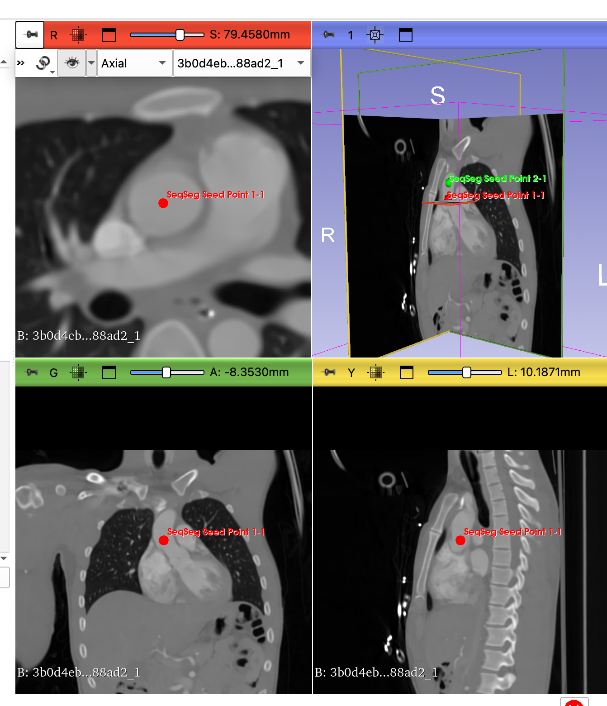
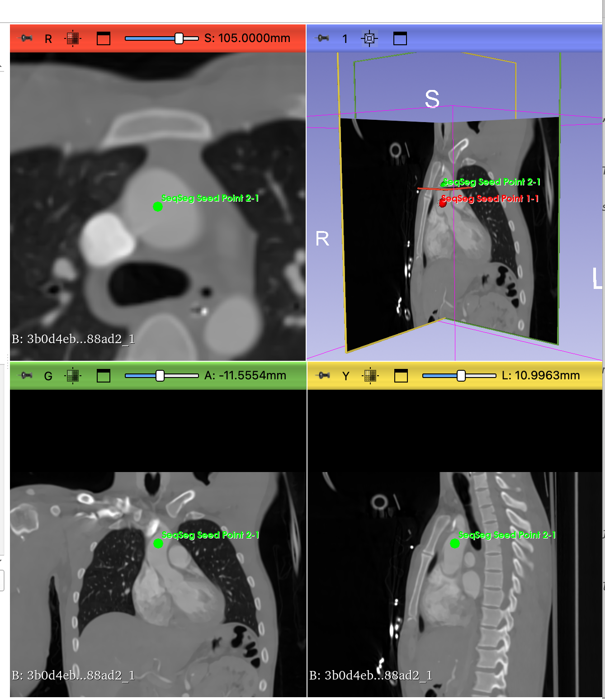

<p align="center">
  
</p>

# SeqSeg Vessel Segmentation (seqseg)



**SeqSeg Vessel Segmentation** is a [3D Slicer](https://www.slicer.org/) module (internal module id: `seqseg`), listed under both SimVascular and Segmentation. It segments tubular structures (coronary arteries, aorta, Fontan pathways, and similar lumens) from CT or MR. You choose a pretrained model and place one or more seed lines. Each seed has its own radius in millimetres. The module runs the [SeqSeg](https://github.com/numisveinsson/SeqSeg) package and loads the segmentation and surface back into Slicer.

The seed line is the start and the tracking direction. It is not the radius: the distance between the two clicks used to be the radius so that each seed could differ, and a long direction then became a radius larger than the vessel. The radius now sits on that seed's row. Choosing a model sets the radius new seeds start with, and the number of tracking steps. Seeds you have already changed keep their own value. The line under the model reads the volume spacing and says whether those numbers are millimetres or centimetres, and what will be done with them. Aorta and Fontan networks were trained in centimetres, so a millimetre spacing is divided by 10 before the network sees it. A centimetre spacing is used as stored, and the radius (still entered in millimetres) is converted to match.

## Publication

If you use the SeqSeg method, Python package, or this extension in research, please cite:

Sveinsson Cepero, N., Shadden, S.C. SeqSeg: Learning Local Segments for Automatic Vascular Model Construction. *Ann Biomed Eng* **53**, 158–179 (2025). [https://doi.org/10.1007/s10439-024-03611-z](https://doi.org/10.1007/s10439-024-03611-z)

## Prerequisites

**Run SeqSeg** installs what is missing. It asks first. The download needs a network connection.

- **PyTorch and nnUNet.** The first run installs `torch` 2.2.2, `torchvision` 0.17.2, and `nnunetv2` (at least 2.5.1; at least 2.7.0 on macOS). If NumPy is 2.x it is downgraded to 1.x, because torch 2.2.2 cannot import against NumPy 2, and Slicer then asks to restart. The confirm dialog says this before anything is installed. Later runs do not downgrade NumPy again.
- **The PyTorch and NNUNet extensions are optional.** If they are already installed, SeqSeg uses them (`PyTorchUtils` and `SlicerNNUNetLib`), including a CUDA wheel chosen from the NVIDIA driver. If they are not installed, SeqSeg installs the same versions itself. Torch goes through [light-the-torch](https://github.com/Slicer/light-the-torch), because a plain `pip install torch` often fetches a wheel with no kernels for the GPU in the machine, and nnU-Net then reports that failure as an out-of-memory error. The SimVascular extension does not declare those extensions as dependencies: SeqSeg is the only module here that needs them, and declaring them would install PyTorch for every user of the meshing modules.
- **The `seqseg` package** (`seqseg>=2.1.1`, then the latest release on PyPI). It is installed with `slicer.util.pip_install`, first with `--no-deps`, then its remaining dependencies, skipping packages Slicer already provides (SimpleITK, torch, torchvision, nnunetv2, numpy, requests, rt_utils).
- **Weights.** Choose a model and press **Run SeqSeg**. If that archive is not on disk, Slicer asks before downloading it into `SeqSeg/weights` beside the user settings file. You do not pick a folder and you do not train a network. Aorta MR and Aorta CT share one archive (236.3 MB, [Zenodo](https://zenodo.org/records/15020477)). Coronary CT is separate (2.2 MB, [Zenodo](https://zenodo.org/records/23813298), folder `Dataset002_CASXCT`, 3d_fullres only). A `Dataset010_SEQCOROASOCACT` folder left from the previous archive is not used. Fontan MR (orig) is separate (about 10.7 MB, [Zenodo](https://zenodo.org/records/20056802)). An older tree in `~/SeqSeg_Weights` is reused. **Fontan MR (003)** has no archive, so it is not listed until a results folder already contains `Dataset091_VMR_FONTAN_003MR`.

Use Slicer's Python for a manual install, not the system `python`. That command installs only the `seqseg` package; **Run SeqSeg** still installs torch and nnunetv2 when they are missing:

```bash
/path/to/Slicer-X.Y.Z/bin/PythonSlicer -m pip install --upgrade "seqseg>=2.1.1"
```

## Tutorial: CTA-cardio

CTA-cardio is a cardiac CT angiography volume from the [Slicer testing data](https://github.com/Slicer/SlicerTestingData) collection. In **Sample Data**, under **SeqSeg Vessel Segmentation**, load **CTA-cardio**. The module registers that entry (SHA256 `3b0d4eb1a7d8ebb0c5a89cc0504640f76a030b4e869e33ff34c564c3d3b88ad2`).

To fetch it by hand: [download](https://github.com/Slicer/SlicerTestingData/releases/download/SHA256/3b0d4eb1a7d8ebb0c5a89cc0504640f76a030b4e869e33ff34c564c3d3b88ad2). Browsers often save that URL with no extension. Rename the file so it ends in `.nrrd` before loading it with **File → Add Data**.

This walkthrough uses **Aorta CT**. Do not choose Coronary CT for it.

1. Open **SeqSeg Vessel Segmentation** and select the volume.
2. Set **Model** to **Aorta CT**. New seeds then start at radius **10 mm**, with 10 tracking steps. The line under the model should say the spacing is in millimetres and will be divided by 10, because CTA-cardio is a millimetre volume and Aorta CT was trained in centimetres. Image Unit and Scale, under **nnUNet Configuration**, are filled in to match that sentence. **nnUNet Type** `2d` is the faster first run on a laptop; `3d_fullres` is the default and takes longer.
3. Click **Add Seed** once for each vessel you want tracked. On that row, set the radius in millimetres (10 mm is the aorta starting value; a second seed can be different). Click once inside the ascending aorta, near the root, then again a short distance along the same lumen toward the arch. Both clicks stay inside the contrast-filled vessel. The line is the direction tracking will walk.
4. Click **Run SeqSeg**. Confirm the weights download if this is the first aorta run (one archive covers Aorta CT and Aorta MR). A progress dialog shows the log and can cancel the process. When tracking finishes, the segmentation is resampled onto the volume, placed under that volume in the data tree, and drawn on the slices. The surface mesh is loaded if SeqSeg wrote one.

The first click, in the ascending aorta:



The second click, further along the ascending aorta. This distance is the tracking direction, not the radius:



## What the panel shows

**Inputs** (open by default): the volume, the model, and the seed lines. Each seed row has its own radius in millimetres. The line under the model is the preset that model just applied. **Add Seed** creates a two-point line and turns on slice intersections so the clicks are visible in the 2D views. **Clear Seeds** removes every SeqSeg line. Extra complete seed lines are extra starts: **Max Branches** is raised to at least that count, and the spin box shows the value SeqSeg will use.

**Segmentation Limits**, **nnUNet Configuration**, and **Output** start collapsed.

- **Tracking steps** (default 10). One step stops at the seed. **Max Branches** (default 1, raised to the number of seeds). **Max Steps per Branch** (default 20).
- **nnUNet Type**: `3d_fullres` or `2d`.
- **Image Unit** and **Scale** are set from the volume spacing when the volume or the model changes. The sentence under **Model** is the description of that choice. Edit these only when that sentence is wrong: millimetre header and a centimetre-trained model use **mm** and **0.1**; a centimetre header and the same model use **cm** and **1**; a centimetre header and the coronary model use **cm** and **10**.
- **Force CPU** adds `-cpu`. Inference is much slower. The module also retries on CPU when PyTorch can see a GPU but has no kernels for it.
- **Output directory**: defaults to `~/SeqSeg_Output/`. The volume is written as `.nii.gz` under `images/`, seeds go to `seeds.json`, and results land in `output/`.
- **Output segmentation**: the node the result is written into. Empty means Run creates **SeqSeg Output** and selects it. A later run replaces the segments in that node instead of adding another segmentation beside it. The node is placed under the volume and resampled onto that volume's grid, then drawn on the slices. The 3D view shows the same segmentation.
- **Generate SimVascular project**: writes `.pth` and `.ctgr` for the classic SimVascular application. Mesh Prep, ROM, and MultiPhysics do not read that project.
- **Load Output File...**: load one segmentation or surface from a previous run. Run already loads both.

## Presets

Choosing a model sets the radius that new seeds start with, and the step count. A seed whose radius you have edited is left alone. Image Unit and Scale then follow the volume. The table is the millimetre case. A centimetre spacing (numbers about ten times smaller, for example 0.08 instead of 0.8) uses Image Unit **cm**, Scale **1** for aorta and Fontan, and Scale **10** for coronary. The radius box stays in millimetres either way.

| Model | Trained in | Image Unit | Scale | Radius | Tracking steps |
| --- | --- | --- | --- | --- | --- |
| Aorta MR | cm | mm | 0.1 | 10 mm | 10 |
| Aorta CT | cm | mm | 0.1 | 10 mm | 10 |
| Coronary CT | mm | mm | 1 | 2 mm | 10 |
| Fontan MR (orig) | cm | mm | 0.1 | 10 mm | 10 |

A fresh panel starts on **Aorta MR** with that row. CTA-cardio is CT, so switch to **Aorta CT** before running it. The same aorta archive installs both.

## Technical details

The module follows the [SeqSeg CLI](https://github.com/numisveinsson/SeqSeg/tree/main). It does not import the `seqseg` package: this file is itself named `seqseg`, so the import would load the module. The console script is run as a process, and the progress dialog drains its output so the panel does not freeze. The child inherits Slicer's environment, whose `PYTHONPATH` lists this extension's `qt-scripted-modules` ahead of site-packages. Left as it is, `from seqseg.seqseg import main` in the console script loads this file. Outside the application `qt` has no `QColor`, and the import dies in `parameterNodeWrapper` with `AttributeError: module 'qt' has no attribute 'QColor'`. Entries that contain a top-level `seqseg.py` are removed from the child's `PYTHONPATH`. The pip package is a directory named `seqseg`, so it stays.

1. The output directory becomes the SeqSeg data directory, with an `images/` subdirectory.
2. The input volume is saved there as `{VolumeName}.nii.gz`. Slicer writes that file in millimetres.
3. `seeds.json` holds one case, named from the volume. Each seed is `[start, direction, radius]`. Coordinates are LPS (the panel's coordinate choice is fixed at LPS world). Each seed's radius is stored on that seed, in millimetres. SeqSeg sizes the patch as radius divided by the spacing numbers in the file, so a centimetre spacing (detected when the largest spacing is below 0.3) is written with the radius divided by 10. A millimetre spacing is written unchanged. Image Unit and Scale do not rescale the seed points; they tell the network how to read that same spacing.
4. The command is `seqseg` with `-nnunet_type`, `-train_dataset`, `-unit`, `-scale`, `-max_n_steps`, `-max_n_branches`, `-max_n_steps_per_branch`, and `-config_name aorta_tutorial`. The SeqSeg CLI's own default config name is `global`; this module always passes `aorta_tutorial`. `-cpu` is added when **Force CPU** is checked, or when a test kernel cannot run on the GPU. `-simvascular 1` is added when the project checkbox is on.
5. The segmentation loaded is the one this run just wrote for this volume: `{case}_segmentation_*_steps`, and only if its modification time is from this run. A previous volume's mask in the same folder is left where it is. A file marked `_0_steps` is treated as failure: tracking never left the seed. The surface loaded is this run's smoothed mesh for the same case.

```text
output_directory/
├── images/          # input volume as .nii.gz
├── seeds.json
└── output/
    ├── {VolumeName}_segmentation_*_steps.mha
    └── {VolumeName}_surface_mesh_*_steps.vtp
```

## Troubleshooting

- **PyTorch / nnUNet install failed, or the install was cancelled.** Read the Python Interactor for the pip output and confirm the machine can reach the network. Run again and accept the dialog. A restart is required after NumPy or torch changes; the module asks.
- **Weights were not downloaded.** Run again and accept the download for the model you selected. Cancelling stops the run before SeqSeg starts. Fontan MR (003) is absent from the list until its dataset folder is already on disk.
- **SeqSeg failed, and the detail is empty.** The dialog includes both stdout and stderr. A tool that prints the reason only on stdout used to show a blank error.
- **"no kernel image is available for execution on the device".** The installed torch build has no CUDA kernels for this GPU. nnU-Net reports it as a memory error. The module reruns with `-cpu`. Check **Force CPU** to skip the failing GPU attempt. A matching wheel can be installed from **PyTorch Util** when the PyTorch extension is present.
- **The segmentation is empty or a 0-step file.** Tracking did not leave the seed. Check that both clicks are inside the lumen, that the second click points along the vessel, and that the model matches the modality. Read the sentence under **Model**: it should agree with the spacing. If it says the run is set to a different Image Unit or Scale than the spacing wants, set those two controls to the values it names.
- **Cancel** stops the seqseg process. It does not roll back a package install that already finished.
- **The window sits on "Running SeqSeg" for a long time.** `3d_fullres` on a full volume is slow. The progress dialog's last line is the process log. `2d` and fewer tracking steps are the shorter test.

## Development

This module began as the standalone [SlicerSeqSeg](https://github.com/numisveinsson/SlicerSeqSeg) extension and is now developed here, as part of the SimVascular extension. For issues and contributions, use this repository.

## License

Unlike the rest of this repository, `SeqSeg/` is licensed under the **Apache License, Version 2.0**. See [SeqSeg/LICENSE.txt](../SeqSeg/LICENSE.txt).

The [SeqSeg](https://github.com/numisveinsson/SeqSeg) Python package is a separate project; see that repository for its license and citation information.
